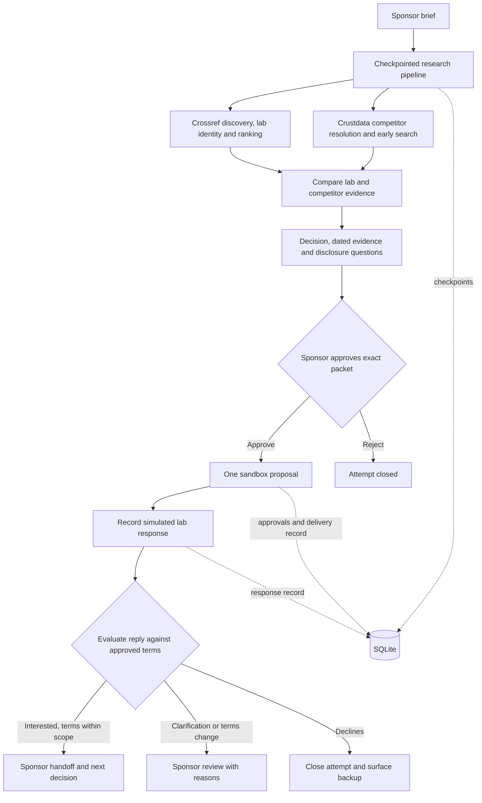

# Patron implementation plan for the three hours before code freeze

**Build the research sponsorship desk through the first lab decision.** An R&D head gives Patron a research problem, a budget, and named competitors. Patron recommends a lab, documents why, checks public industry relationships, and sends an approved proposal to a sandbox outbox. A teammate then plays the lab and responds. Patron records the response and delivers a sponsor handoff with the proposed scope, budget, outstanding disclosures, and next decision.

The human service being replaced is the technology scout’s work of finding and verifying labs, preparing a sponsorship proposal, and collecting the lab’s initial position. The finished work is a documented outcome of that first round. A response of interest produces a decision-ready handoff. A decline closes the attempt with a reason and a named backup. A request for clarification returns the lab’s specific questions and assigns the next action to the sponsor. Contract signature and funding belong to later stages of the sponsorship lifecycle.

Planning baseline is Patron commit `8c0316155ecd14c44bbe5e9137ac0a8219f9a1a9`. The repository already contains live Crossref research, Crustdata competitor research, deterministic ranking, stage checkpoints, approval bound to a packet hash, and a sandbox email outbox. The implementation below adds the lab-side response and makes due diligence visible in the handoff. [Patron repository](https://github.com/Hem810/patron/tree/8c0316155ecd14c44bbe5e9137ac0a8219f9a1a9) · [Existing architecture](https://github.com/Hem810/patron/blob/8c0316155ecd14c44bbe5e9137ac0a8219f9a1a9/docs/architecture.md)

## Demo and impact

Use one sponsor request about reducing clinker in cement with calcined clay, with a ₹50 lakh ceiling and UltraTech named as a competitor. Crossref establishes technical fit. Crustdata resolves the competitor and finds public reporting about industry–lab or industry–institute relationships. The public finding becomes a specific disclosure question in the proposal, and the simulated lab answers that question. Show the exact research record, reported passage, dates, reply, and sponsor decision in order.

The lab replies **interested** with an earliest start, proposed total budget, and an answer about overlap. Patron calculates headroom against the sponsor’s ceiling and shows any unresolved questions. If the budget exceeds the ceiling or a disclosure needs review, the handoff says **sponsor review required** and explains why. This makes the value visible on a concrete decision about a ₹50 lakh proposed project. Report measured run time, source calls, and credits from the actual run. An estimate of manual scouting hours or avoided spend needs a measured comparison.

Use live public evidence where available. Label saved evidence `replayed` and the lab’s response `simulated`, independently. Every prepared scenario uses a named fixture or an explicit teammate role-play. During the event, the proposal remains in the `.invalid` sandbox outbox and the reply is recorded locally.

## Modular architecture



| Boundary | Module and responsibility |
| --- | --- |
| Research and external sources | Keep `papers.py`, `crustdata.py`, `rivals.py`, and the shared `net.Client` path. Preserve bounded concurrency, request caching, and the cost ledger. Existing competitor prefetch can overlap paper research. Lab-specific checks depend on the shortlist. |
| Selection and proposal | Keep the deterministic `rank.py` → `decide.py` → `packet.py` flow. Add structured disclosure questions to the packet before hashing. Keep dated passages and source URLs available for the handoff. |
| Lab response and action | Add `patron/handoff.py` for response validation, deterministic outcome rules, and sponsor handoff assembly. Keep CLI parsing in `__main__.py` and persistence in `store.py`. |
| State and delivery | Reuse the existing `jobs`, `steps`, `approvals`, and `actions` tables and the sandbox delivery adapter. Add an append-only `lab_responses` table keyed by `(job, packet_sha)` for one reply per proposal version in this sprint. |
| Operator interface | Add a CLI entry such as `python3 -m patron record-reply JOB --file reply.json` and extend `show JOB` to report the resulting handoff. Use the existing proposal and web view during the demo if they help. |

**Concurrency.** Use the existing worker pools for independent source queries. Keep side effects under a single owner per case. Do not introduce additional LLM agents whose work duplicates the existing stages. If a provider slows down, the case keeps its checkpointed work and reports which evidence was unavailable.

**Scale path after the event.** Keep the same stage and provider boundaries. When multiple worker machines are needed, move persistence to Postgres and claim `(job_id, stage)` tasks from a durable queue with leases. Share rate and credit budgets by provider and account across workers. Store packet and outbox artifacts in durable object storage. Keep approval and reply correlation tied to packet versions, and use a transactional outbox plus provider idempotency keys when adding live delivery. Keep this sprint on SQLite and the standard library.

## Integration contract to agree in the first 15 minutes

**Packet.** Hem owns the structured `disclosures` array consumed by the handoff. Each entry uses `id`, `question`, and `evidence_ids`. Use stable IDs derived from the question type and relevant party or relationship. Reuse source evidence IDs. A packet created before this field existed can still be shown and processed using its stored question list and a generic outstanding-disclosure marker when appropriate. Any new disclosure included in a packet is covered by the packet hash.

**Reply.** The fixture and CLI input use the same schema. The CLI supplies the job ID. The payload must include the full `packet_sha`, a stable `message_id` within the job and packet, an `intent` of `interested`, `clarification`, or `declined`, and a nonempty `message`. An interested reply can include `proposed_budget_inr`, `earliest_start`, and `disclosure_answers`, a map keyed by disclosure ID. Use positive integer rupees and ISO calendar dates. The app supplies `received_at` and fixes `source` to `simulated` for this entry point. Treat message text as data and escape it wherever rendered.

Example payload for the teammate playing the lab. Use the SHA and disclosure ID from the delivered packet.

```json
{
  "packet_sha": "<full approved packet SHA>",
  "message_id": "lab-demo-01",
  "intent": "interested",
  "message": "We can take on the proposed scope in January.",
  "proposed_budget_inr": 4900000,
  "earliest_start": "2027-01-11",
  "disclosure_answers": {
    "<disclosure ID from packet>": {
      "status": "none_declared",
      "text": "The published partnership was with another team. We have no active overlapping work to disclose."
    }
  }
}
```

**Transactions.** Record a reply only for the current packet when the approved send exists, identified by the existing sandbox action key derived from `['send', job, packet_sha]`, and the job has reached `sent`. In one `BEGIN IMMEDIATE` transaction, check the job, packet and action, then insert the reply. An identical replay returns the stored response. A changed payload or different reply for that version returns a clear error. Preserve the delivery status and derive the lab status from the persisted reply. Coordinate `choose()` and `review()` under the same existing job lock, or make both compare and update the current draft transactionally, so changing labs cannot race approval. Keep research and network calls outside database transactions.

**Handoff.** Include the lab, packet hash, send record, reply ID, simulated label, sponsor budget, proposed budget, headroom, unanswered disclosure IDs, applicable evidence, and next action. `interested` maps to `ready_for_sponsor_decision` only when both budgets are known, the quote is within the ceiling, a start date is supplied, and required disclosures are answered without flagged or unresolved overlap. Each structured answer uses a status of `none_declared`, `overlap_declared`, or `unknown` plus optional text. Display `none_declared` as the lab’s statement and surface public relationship evidence alongside it. If a material direct relationship remains unresolved, require sponsor review. Clarification maps to `sponsor_review_required`. Decline maps to `declined`, with the highest-ranked evaluated backup if one exists. These states never send a second proposal or release funding.

**Evidence coverage.** Show whether evidence came from Crossref, Crustdata search, a fetched Crustdata page, or headlines. Keep completed checks, missing sources, ambiguous identities, and unconfirmed mentions distinct. Institution-only relationships create questions about overlap. A dated and source-backed direct link can change the recommendation under the existing policy. Hem’s fixture should demonstrate the before/after selection and which evidence caused it.

## Three-hour build split

Use time elapsed from the start. Both agents branch from the same Patron commit. Agree the interface and fixture IDs before coding, work on separate branches, and open integration diffs by T+90. The user’s agent is the merge owner and the only owner of `README.md`; Hem owns the architecture diagram update in `docs/architecture.md`.

| Time | Your agent · reply and sponsorship lifecycle | Hem’s agent · evidence, decision, and verification |
| --- | --- | --- |
| **T+00–15** | Share reply schema, state names, and integration example. Confirm a macOS/Linux runner and run the baseline suite. | Confirm the evidence IDs and packet field contract against `rivals.py`, `decide.py`, and `packet.py`. Identify a Crustdata example with a source passage, date, and actionable disclosure question. |
| **T+15–65** | Implement `handoff.py`, additive `store.py` schema, CLI wiring, and lifecycle tests in `tests/test_handoff.py`. Exercise the existing approval and sandbox-delivery path. | Add structured disclosure questions and evidence coverage to `rivals.py`, `decide.py`, and `packet.py`. Add targeted tests in `tests/test_evidence.py` and create deterministic replay fixtures under `tests/fixtures/`. |
| **T+65–90** | Finish reply replay and stale/undelivered guards. Check the lab choice and approval race in `pipeline.py`. Run reply tests from a fresh and an existing database. | Prove Crustdata’s effect on one decision with a fixture and run a bounded live case if credentials and source availability permit. Add explicit labels for source coverage and update `docs/architecture.md`. |
| **T+90–125** | Merge evidence changes before testing the full flow. Validate the actual CLI invocation on the merged branch and document it in `README.md`. | Cross-review the lifecycle branch. Run the existing suite plus targeted evidence tests. Prepare the 15-case proof checklist and confirm expected results against tests or reproducible fixtures. |
| **T+125–150** | Rehearse the approved send, simulated reply, and sponsor handoff. Record observed calls, credits, wall time, and CLI outputs in the demo notes or README. | Rehearse the partial-source and adverse-reply cases. Independently verify the evidence chain and actual results. Mark any case without runtime coverage as unverified. |
| **T+150–180** | Freeze feature work. Fix demo blockers, run the final gate, prepare the submission from the passing commit, and retain a known-good replay. | Review the final diff and judging claims. Check the replay on a clean data directory and provide the exact commit and pass counts. |

The first integration gate is a successful baseline proposal with one accepted simulated reply. If that is missing at T+90, reduce output to CLI text and use deterministic fixtures. Cut any additional parser, dashboard, framework, or provider. If live calls fail, switch to explicitly labelled replay for the demo and record the source failure separately. Keep approval, evidence traceability, reply correlation, duplicate protection, and the 15-case checklist in scope.

## Fifteen edge cases and expected evidence

Show three in the live walkthrough at most. Include this entire checklist in the build evidence, with test names or fixture commands and actual pass/fail status. **Baseline** means a related behaviour or test is present in the reviewed source. **Add** means the sprint needs to prove the behaviour below.

| # | Scenario | Expected behaviour and evidence | Owner |
| --- | --- | --- | --- |
| 1 | Sponsor says only “find me a lab” | One clarification question, `needs_input`, and no send action. Add fixture. | Hem |
| 2 | Crossref succeeds but returns no evidence meeting the technical threshold | `insufficient`, missing requirement identified, no proposal emitted. Baseline ranking coverage. | Hem |
| 3 | Crossref is unavailable | `failed` with a source outage. Previously completed checkpoints remain available on retry. Baseline outage test. | Hem |
| 4 | Two professors share a name across institutes and one record lacks ORCID | Candidates stay separate unless the existing identity rules establish a match. Baseline identity tests. | Hem |
| 5 | The strongest-looking paper is marked retracted | Paper excluded from scoring and exclusion reported in the packet. Baseline scoring test; verify report. | Hem |
| 6 | A competitor name resolves to multiple plausible entities | Mark identity ambiguous, never assign a guessed Crustdata company ID, and surface it in the handoff when relevant. Baseline matching tests plus coverage fixture. | Hem |
| 7 | A webpage mentions both parties without describing a relationship | At most an unconfirmed lead, with the source visible. It does not affect the recommendation. Baseline relationship tests. | Hem |
| 8 | A dated source directly connects the top researcher to a named competitor | Qualified backup can become the pick. Result shows which evidence changed the decision and any disclosure question. Baseline decision test plus structured evidence fixture. | Hem |
| 9 | Crustdata exhausts its credit budget or a billable call times out ambiguously | Report incomplete coverage and preserve the cost ledger. Never repeat the ambiguous billable call. Baseline network tests plus coverage check. | Hem |
| 10 | Approver opens a draft, then someone changes the recommended lab | Stale hash refused. Concurrent change and approval leave one consistent packet, approval, and send target. Baseline stale test plus race regression. | Your agent |
| 11 | Process dies after writing the message and before recording the action | Resume with one `.eml` and one matching action. Baseline Unix kill-and-resume test. | Your agent |
| 12 | Lab reply arrives before delivery or points to another packet | Refuse the reply and leave that job’s response state unchanged. Add regression for both inputs. | Your agent |
| 13 | The same lab response is submitted again | Return the original response without new records. Changed content using the same ID is refused. Add regression including concurrent submits. | Your agent |
| 14 | Lab is interested but quotes ₹58 lakh against a ₹50 lakh ceiling, or discloses overlap | Show `sponsor_review_required` with the ₹8 lakh gap or the overlap and its source. No automatic agreement or payment. Add fixture with both variants. | Your agent |
| 15 | Lab declines, or asks a question that must be answered before proceeding | Decline closes this attempt and surfaces a checked backup. Clarification records the exact question and the sponsor as the next actor. Neither branch sends a new proposal. Add fixtures for both. | Your agent |

## Freeze gates and judging walkthrough

- **Automated gate.** Run `python3 -m unittest discover -s tests` on macOS or Linux. Run the merged workflow from a clean `PATRON_DATA` directory and open an existing database to confirm the additive schema. Check all 15 rows and record the commit, test counts, and any unverified cases. Native Windows could not import the reviewed baseline because `fcntl` is unavailable, and WSL was inaccessible in this workspace. The team’s supported runner needs to establish the test baseline.
- **End-to-end gate.** Run one brief through research, proposal, approval, and delivery. Record the teammate’s simulated reply via the normal CLI. Restart and confirm the same handoff can be retrieved. Replay the reply and verify one reply row and one outbox message. Show the value and run costs as reported by the packet and ledger.
- **Two-minute walkthrough.** Spend about 15 seconds on the sponsor’s problem, 35 on the recommendation and the Crustdata passage that changes a decision or adds a disclosure, 25 on approving the exact proposal and showing the sandbox receipt, and 35 on the lab reply and sponsor handoff. Use the remaining 10 seconds for the edge-case evidence and measured run cost. Use a ready replay if the live run exceeds the demo window.
- **Code review gate.** Review the final diff for clean module ownership, additive schema changes, explicit error cases, unknown-vs-verified evidence states, tests through the normal workflow, reproducible fixtures, and absence of keys or private data in the commit. The architecture should match the checked-in code at freeze.

[ContextCon dashboard](https://crustdata.com/contextcon/bits-pilani-2026/dashboard#guide) · [Crustdata capabilities and permissions](https://docs.crustdata.com/general/capabilities.md)
