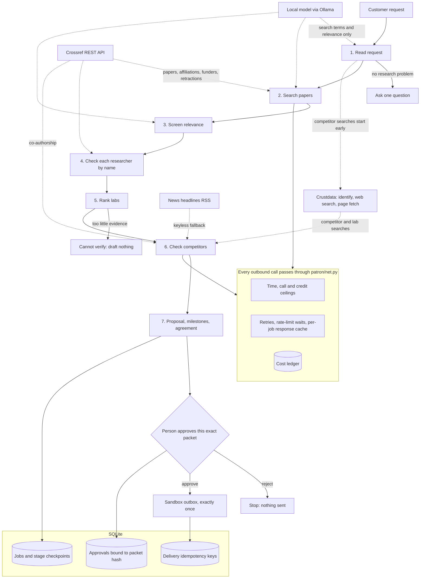

# Architecture

| Concern | Where |
| --- | --- |
| Request reading, money, names | `patron/intake.py` |
| Paper discovery and screening | `patron/papers.py` |
| Same person or institution, one record | `patron/identity.py` |
| Scoring (no model involved) | `patron/rank.py` |
| Competitor evidence | `patron/rivals.py`, `patron/crustdata.py` |
| Choice and explanation | `patron/decide.py` |
| Proposal and agreement | `patron/packet.py` |
| Limits, retries, ledger | `patron/net.py` |
| Checkpoints, approval, resume | `patron/pipeline.py` |
| Exactly-once delivery | `patron/deliver.py` |

A hundred times the volume: move SQLite to Postgres, run stages from a worker queue, and share one rate limiter per
source. A second client: add a tenant column to every table and give each tenant its own configuration and ceilings.
