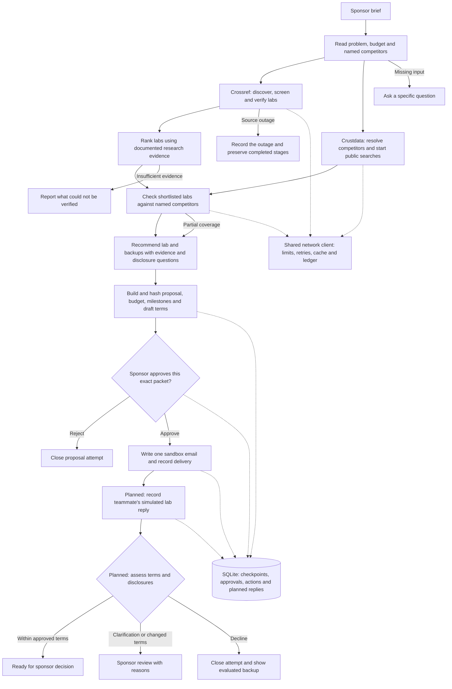

# Patron architecture

Patron takes a research sponsorship brief through technical scouting, public due diligence, proposal preparation and the first lab decision. The code at the reviewed baseline reaches approved sandbox delivery. This document describes that baseline and the planned offer, reply, and sponsor handoff extensions. [Implementation plan and freeze gates](../IMPLEMENTATION.md)

## Modules and ownership boundaries

| Concern | Reviewed baseline | Sprint change |
| --- | --- | --- |
| Intake and identity | `patron/intake.py`, `identity.py` | Request missing budget when the case needs a priced offer. Preserve identity evidence and uncertainty. |
| Technical evidence | `patron/papers.py`, `rank.py`, `llm.py` | Preserve current ranking rules and evidence traces. The model assists with search terms and relevance. |
| Industry relationships | `patron/crustdata.py`, `rivals.py`, `decide.py` | Carry source coverage and evidence IDs into disclosure questions. A reported institute tie can become a question for the lab. |
| Proposal and offer | `patron/packet.py` | Add reviewable offer terms and disclosures before hashing. Render the approved terms in the sandbox email or offer attachment. |
| Orchestration and execution | `patron/pipeline.py`, `deliver.py`, `__main__.py` | Correlate approval, sandbox delivery and reply by job and packet version. Expose recording and recovery through the CLI. |
| Sponsor handoff | — | Add `patron/handoff.py` for validation and deterministic outcomes. |
| State and outbound requests | `patron/store.py`, `net.py`, `config.json` | Add reply storage. Keep the existing per-job source cache, limits, cost ledger and delivery action record. |

Network work runs outside store transactions. Parallelise independent provider lookups using the existing bounded pools. Crustdata competitor-side research can start after intake. Lab-specific research joins after the shortlist exists. The coordinator writes stage outputs and controls actions. Deterministic rules govern ranking, approval, financial comparisons, and handoff status.

## Evidence and state

A source record can support a technical fit claim, a public relationship, or a disclosure question. Carry the source URL, dates, exact passage and ID across the proposal and handoff. Represent missing coverage explicitly. A simulated lab statement is stored separately from public evidence. Questions about active projects, capacity and private agreements stay open until the appropriate party answers them.

Approvals refer to immutable packet versions. When the underlying draft changes, its approval hash changes. The sandbox delivery record and outbox filename use the existing job-plus-packet key. Resume can reuse the file if the process stops before recording the action. Replies require a matching delivery and are inserted once per delivered packet in a transaction. A historically delivered job can retain its delivery status while the reply updates its sponsor-facing outcome.

## Scaling path

Keep one orchestrator and SQLite for this sprint. Stage functions consume a brief, configuration and saved outputs, and return a serialisable result. For future provider or stage replacement, add an explicit stage version and validate checkpoint compatibility. Pin the stage configuration for an in-progress job. Roll forward with a migration or an explicit restart from the earliest changed dependency.

When one process is no longer enough, put durable job and stage records in Postgres, claim work with per-stage leases, and enforce quotas across workers for each provider account. Scope jobs, approvals, data and secrets to the sponsor tenant. Store approved packet and message artifacts durably. For live delivery, use a transactional outbox and a provider idempotency key. Correlate authenticated replies to the same immutable packet versions.

[Implementation plan, work split, and 15 edge cases](../IMPLEMENTATION.md)
